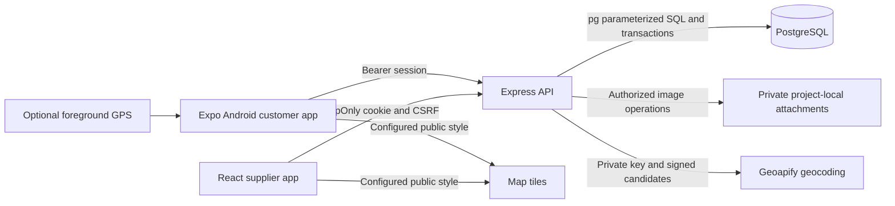

# Architecture

Updated 19 October 2026 against the first-release source. The 18 October documentation described an Expo starter and empty API/web directories; that is a historical baseline. TypeScript implementations now connect the customer application and supplier workspace to Express and PostgreSQL. Implementation evidence and acceptance evidence are distinct: see [verification](verification.md) and [traceability](traceability.md).

Related: [requirements](requirements.md), [schema](schema.md), [API contract](api.md), [workflows](workspace.md), [setup](setup.md).

## Components and repository boundaries

| Location | Implemented responsibility |
| --- | --- |
| `aqours-api/src/` | Express 5 routes, role/ownership authorization, Zod input validation, sessions, publication, guidance, assistance, uploads and stock transactions |
| `aqours-api/migrations/` | Ordered SQL migrations for the JSONB domain record store, relational credentials/sessions/events/notifications/operations and exact stock ledger |
| `aqours-web/src/` | React/Vite supplier login, overview, inbox/detail, MapLibre map, incidents, advisories, assistance, distribution and admin settings |
| `aqours-app/src/app/` | Expo Router customer navigation and protected route composition |
| `aqours-app/src/features/` | Focused home, report/location/photo, guidance, assistance and notification screens |
| `aqours-contracts/src/` | Shared TypeScript public DTOs, common enums and response contracts; no database or credentials |
| `compose.yaml` | PostgreSQL 18.6 Alpine service, loopback host port, health check and named volume backed by a configured project-local directory |
| `verification/`, component tests | API/database and browser verification plus focused client checks; see the verification ledger for executed results |

The user adopted one supplier, seeded individual accounts, the customer/staff/admin split, rules/questionnaire/action cards, REST contracts, workflows and metrics as first-release defaults. Academic acceptance of decision support remains externally unverified. No AI integration is implemented. Android is the customer target; optional/deferred capabilities remain in [requirements](requirements.md).

## Data flow and trust boundaries

The API is authoritative for role and record access, transitions, publication, guidance and stock. Customer identity comes from the session. Staff/admin operational reads contain protected operational information; explicit response projections in `services/projection.ts` construct customer DTOs from allowlisted fields. An incident's internal changes are separate from its immutable published update. Internal notes are private events, excluded from public timelines and notifications.

`app.ts` installs security headers, CORS for the configured browser origin, bounded JSON parsing, rate limiting and route modules. `auth.ts` verifies a live session and current account state. `http.ts` applies role guards, scoped idempotency, transaction handling and common envelopes/errors. Route modules validate request fields and orchestrate domain services. `store.ts` provides parameterized record persistence, version checks, immutable events and deduplicated notifications; `db.ts` provides transactions and an explicit uncertain-commit error. The store uses a flexible internal `Doc` representation; public contracts do not make every internal JSONB record statically typed.

## Authentication and permissions

Passwords are salted scrypt hashes in `credentials`, separate from public profile records. Sessions store a SHA-256 token digest, expiry, client kind, CSRF token and revocation time. Browser login establishes an HttpOnly, SameSite=Lax cookie scoped to `/api/v1`, with Secure enabled in production; mutations require the configured Origin and `X-CSRF-Token`. The web client keeps CSRF state in memory and restores identity from the session endpoint. Android uses a bearer token in Expo SecureStore, verifies the server identity before mounting private routes and retains a pending-revocation state when server logout cannot be confirmed.

Operational staff/admin can review reports/incidents, publish incident updates and fulfill assistance/distribution. Admin alone provisions accounts/connections/zones, versions approved guidance/rules and publishes/lifts official advisories. Account security changes revoke sessions. Customer lookups verify ownership of reports, photos, messages, guidance, requests and notifications; published data is separately scoped. Navigation visibility is supplemental to backend checks. See the full matrix in [requirements](requirements.md).

## Location and maps

Saved service connections and report issue-location snapshots remain separate. Optional GPS uses foreground permission without geocoding; denied permission leaves saved-address entry available. Typed addresses use the authenticated Geoapify adapter with configured region bias/filter, a timeout, a limited candidate list and expiring signed candidate tokens. Missing credentials/provider failure returns an explicit unavailable result; unresolved addresses can be submitted for review. Alternate issue zones require review rather than inheriting a saved zone. GPS accuracy is retained in meters, with null for unknown/legacy records. High-accuracy one-shot acquisition avoids a forced Google network-accuracy prompt; the bounded timeout retains address fallback. Confirming a coordinate never confirms a service zone.

`records.latitude` and `records.longitude` are generated `DOUBLE PRECISION` columns from JSONB, with paired-null/range checks and a report viewport index. Map responses use `[longitude, latitude]`. Optional Polygon/MultiPolygon GeoJSON is validated for display; explicit zone/connection associations establish applicability. Map clusters never establish outages or supply connectivity. Staff viewport queries apply numeric bounds, filters, limits and truncation/unlocated counts. Antimeridian-spanning bounds are rejected.

Web MapLibre is implemented in `aqours-web/src/map/`; native MapLibre preview is in `aqours-app/src/features/location/map-preview.native.tsx`. Lists/forms remain usable when basemaps fail. Geoapify, map rendering and style/tile provisioning are independent integrations. Actual native basemap/circle/picker/protected-image checks are recorded in the [native ledger](native-verification.md); controlled GPS/native-supplier coordinate equality passed; live Geoapify equality still requires private operator configuration.

## Publication and independent lifecycles

Report review, incident status, published incident updates, advisory state and assistance outcomes remain independent. Explicit publication saves an immutable snapshot, relevant history and deduplicated notification rows in one database transaction. Notifications use `(user_id, source_event_key)` uniqueness, including overlapping report/connection audiences. In-app foreground refetch/polling reads persisted notifications; no external delivery worker or outbox is required by this implementation.

Customer advisory projections retain only explicitly targeted owned connection IDs; matching public zones uses confirmed owned connections. Native Home/detail display planned dates and matching own references/address without disclosing other households.

Only explicit authorized lifting ends a published quality restriction. Incident resolution and scheduled end times do not lift it. Still-affected feedback returns one report to review while retaining earlier substantive-resolution history. Guidance evaluation uses current published sources, approved rule versions, answers and pickup availability; historical evaluations keep input/source references and a source signature so a changed source marks them non-current. The customer chooses an action or declines; evaluation/choice never creates or accepts assistance.

## Assistance and stock

Callback, inspection and water-support requests share a versioned workflow and owned report context. Acceptance requires an active staff/admin owner; scheduling, rescheduling, immediate-support exceptions, unavailability and completion have explicit field/reason checks. Water completion goes through collection rather than the generic transition endpoint. Appointment and transition events retain prior context. Public history projects only validated old/new appointment instants from event metadata; arbitrary audit metadata stays private. Generated appointment/restoration text is localized on read without rewriting immutable UTC records.

Stock uses relational `stock_sessions` and `allocations`, with `NUMERIC(14,2)` liters and decimal string DTOs. Acceptance serializes on session/request locks, rechecks eligibility and stock and creates a reserved allocation plus reference atomically. Collection changes reserved to collected once; cancellation releases an uncollected allocation. Session cancellation makes active uncollected requests unavailable with support follow-up and retains collected outcomes. Database triggers additionally prevent overcommitment, reducing totals below commitments, invalid ledger transitions and deleting allocation history. The invariant is `remaining = total - reserved - collected`.

## Operations and verification limits

Migrations use `pg` and a SQL migration ledger. Development-only seeding is explicit and repeatable; reset requires deliberate confirmation. Compose storage survives container replacement; backup/restore also includes private attachment bytes and migration state. See [setup](setup.md) for commands and backup instructions and [demo](demo.md) for fictional fixtures.

Uploads are separate from report creation. The API decodes still JPEG/PNG/WebP with sharp, enforces 5 MiB and pixel limits, strips metadata by reencoding, writes private random filenames under a project-local directory and returns metadata only after database success. Ordinary rollback removes pending files; uncertain commit preserves them for retry resolution. A crash between filesystem and database operations can leave an orphan; no automated retention/orphan-reconciliation service is implemented.

UTC event instants are displayed in `Asia/Manila`. First-response and first-resolution fields derive from qualifying review events, with sample/pending/excluded counts and retained earlier resolution history. No-data duration is null. General collection reads currently load domain rows before pagination; this is a demonstration-scale implementation, not a measured large-deployment architecture. Rate limits are process-local. HTTPS deployment, real provider credentials, production retention/monitoring and real-water-safety content approval are deployment concerns.

Native MapLibre 11.5.0 is pinned with Expo 57 / React Native 0.86.3 configuration; Expo Go cannot run that native map. Actual signed standalone APKs run on KVM-backed Android29/36; [native evidence](native-verification.md) distinguishes each verified workflow and build. Expo57 uploads use FileSystem File bytes, and RN0.86 Android protected images use the array-source branch to retain authorization headers. Same-identity foreground resource refresh preserves mounted draft/upload state with explicit stale labels; identity changes and denied results clear it. Do not mark the release complete from source, typechecking or browser tests alone; consult the current [verification ledger](verification.md).
