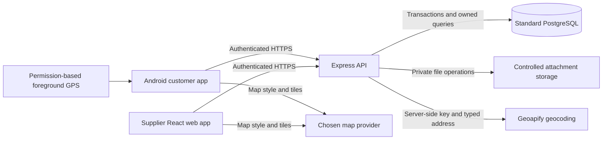

# Architecture

Documentation baseline: 18 October 2026. Product source: the supplied Water Supply Reporting and Customer Assistance brief v0.4. This is a design baseline for a documentation-only task, not a statement that the system below has been built.

Related documents: [Index and feature specs](README.md) · [Requirements](requirements.md) · [Database schema](schema.md) · [Workflows and workspace](workspace.md).

## Implementation status

| Component | Verified repository state | Evidence |
| --- | --- | --- |
| Customer application | Expo React Native TypeScript starter with Home/Explore example screens, theme components and navigation; no Aqours reporting, assistance or authentication workflows | [Package](../aqours-app/package.json), [routes](../aqours-app/src/app/index.tsx), [layout](../aqours-app/src/app/_layout.tsx) |
| API | `aqours-api/` exists and is empty; no server, endpoints or authorization | Repository directory inspection |
| Supplier application | `aqours-web/` exists and is empty | Repository directory inspection |
| Persistence and integrations | No database migrations, seed, Compose file, attachment service, Geoapify client or MapLibre integration | Repository file inventory and mobile package/configuration |
| Shared tooling | No root package manifest, configured TypeScript workspace, shared contracts package or root README | Repository root inspection |

The mobile manifest declares Expo `~57.0.30`, React Native `0.86.3`, React `19.2.3` and TypeScript `~6.0.3`; the lockfile records the same package versions. These are the current starter dependencies, not a tested MapLibre compatibility matrix. [App configuration](../aqours-app/app.json) contains Expo Router and splash-screen plugins, with no MapLibre plugin. Android/iOS native directories and EAS configuration are absent.

In the rest of this document, **confirmed** means a product choice in the brief, **required** means target behavior, **proposed** means an implementation default awaiting implementation review, and **deferred** means outside the first release. None of these labels implies implementation.

## Confirmed technology and product boundaries

| Boundary | Confirmed choice | Responsibility |
| --- | --- | --- |
| Customer client | React Native and TypeScript, existing Expo setup; Android only | Customer's own reports, service address, native location preview, assistance requests and in-app updates |
| Supplier client | React and TypeScript with MapLibre GL JS | Operational inbox, map, incidents, notices and assistance/distribution management |
| API | Express and TypeScript | Authentication, record-level authorization, validation, business rules, recommendation evaluation and transactional writes |
| Database | Containerized standard PostgreSQL | Durable accounts, reports, workflows, notices, allocations, notification records and audit history |
| Location rendering | MapLibre GL JS on web; MapLibre React Native on Android | Display confirmed coordinates and published shapes; no supply-network inference |
| Address lookup | Geoapify Forward Geocoding through Express | Return address candidates for explicit customer/staff confirmation |
| Demonstration data | Fictional accounts, people and service zones | Clearly label synthetic incidents, notices, restoration estimates and water availability |

One supplier and a one-week demonstration are proposed release assumptions. Multiple suppliers, iOS, billing/payments, IoT, automated water-safety diagnosis, vehicle/repair routing, home delivery and app-store publication are deferred. Academic acceptance of the proposed rules-based assistance remains unresolved; an AI chatbot is optional future scope.

## Repository organization

Preserve the existing layout rather than adopting the brief's proposed `apps/*` rename:

```text
aqours/
├── aqours-api/       # Empty; intended Express backend
├── aqours-app/       # Existing Expo customer starter
│   ├── src/app/      # Actual Expo Router routes
│   ├── src/components/
│   ├── src/hooks/
│   └── src/constants/
├── aqours-web/       # Empty; intended supplier React application
├── docs/            # Product and technical documentation
├── .loop/           # Execution goal, state and verification history
├── AGENTS.md
└── PROGRESS.md
```

The following organization is proposed, not present: API feature modules with separate routes/controllers, validation, services and database repositories; supplier screens with separate reusable components, hooks and request clients; mobile feature screens that use the existing Expo Router routes and keep non-route code outside `src/app/`.

A shared contracts package may later provide DTOs, enum values and validation schemas. Its location, package manager/workspace tooling and validation library are not selected here. Clients may consume public contracts but must never import database access, server credentials or server-only code. Vite for the supplier client is proposed; no bundler or new dependency is installed by this documentation task.

Follow the repository's physical line limits for handwritten TypeScript/TSX: 200 in the API, 250 in the web client and 300 in the mobile client, including tests. Split by responsibility before reaching a limit. Dependency additions require the approval described in [root guidance](../AGENTS.md).

## Target components and trust boundaries

Every box and connection below is a target design; only the mobile starter currently exists.



The API is the sole authority for access, workflow transitions, notice publication, assistance acceptance and stock changes. Client validation improves usability but does not establish authorization or integrity. Customer requests derive identity from the authenticated session, not from a submitted customer ID.

Proposed API layering:

1. HTTP middleware authenticates, limits requests and validates body/query/file input.
2. Controllers translate requests into typed service calls and return a consistent response/error contract.
3. Domain services check ownership, permissions, allowed transitions, recommendations and idempotency.
4. Repositories perform parameterized queries and transactions; external adapters isolate Geoapify and file storage.
5. Response mappers explicitly allow customer-visible fields and exclude internal notes, other households' coordinates and contact information.

The exact session mechanism, SQL/migration tooling, upload adapter and validation packages remain implementation choices. Password hashing, revocable sessions/logout, secure mobile credential storage and protected browser authentication/state-changing requests are requirements. A proposed browser default is an HttpOnly secure cookie with suitable SameSite/CSRF defenses; it is not implemented or a reason to place credentials in browser storage.

## Proposed API surface

REST under `/api/v1` is proposed. These are groups, not live routes or a completed API contract:

| Group | Caller and purpose |
| --- | --- |
| `auth`, `me`, `me/connections` | Login/logout, current identity and owned saved service connections |
| `locations/geocode` | Authenticated address candidate lookup; rate limits and server-side key |
| `reports`, report messages/attachments | Owned submissions, tracking, clarification, timelines and still-affected feedback |
| Published incidents/advisories | Customer-visible updates and affected areas, excluding unpublished content and raw household data |
| `assistance-requests`, `pickup-sessions` | Owned service requests and eligible published pickup options |
| `notifications` | Current user's persisted notifications and read state |
| `staff/reports`, `incidents`, `map`, `metrics` | Supplier operations with staff/admin authorization |
| Staff advisories/settings/assistance/distribution | Authorized publication, configuration, fulfillment and stock management |

Use server validation, pagination and structured error codes. The eventual contract must distinguish validation failures, unauthenticated/forbidden access, stale/conflicting transitions, unavailable stock, upload failure and upstream geocoding failure. Mutation keys must be scoped to actor and operation, with repeat requests returning the original result and incompatible reuse rejected. Stable publication/allocation identifiers prevent repeated deliveries or collections.

## Location flow

1. A customer selects an owned saved service connection or enters an issue address. Keep the saved service address and this report's issue location separate.
2. For typed addresses, Express calls Geoapify with a private key, service-region bias/filter, limited results and a timeout. Return candidates with formatted addresses, longitude/latitude and confidence for confirmation. Geoapify supports these candidate fields and location filters; confidence does not establish water-network membership. [Geoapify Forward Geocoding](https://apidocs.geoapify.com/docs/geocoding/forward-geocoding/).
3. For GPS, request optional foreground permission and use device coordinates directly. GPS does not require forward geocoding. Denied/unavailable GPS returns to saved-address entry; no continuous background tracking is required.
4. Display the chosen position on native MapLibre for confirmation. Save the source, confirmation/review state and coordinates. Missing/ambiguous geocoding or unconfirmed service zones retain the report for staff review; never invent coordinates or substitute `(0, 0)`.
5. Store WGS84 latitude/longitude in ordinary `DOUBLE PRECISION` columns with range and paired-null checks. Serialize GeoJSON points as `[longitude, latitude]` for both clients. See [schema](schema.md) for proposed integrity rules.
6. Staff map queries apply numeric viewport bounds and category/status/time filters. Unlocated reports remain visible in the inbox. Customer location responses contain only owned records and published location data.

Service-zone IDs and staff-confirmed associations determine report/incident/notice matching. Optional zone and affected-area Polygon/MultiPolygon GeoJSON in JSONB is for display; no PostGIS extension or inferred hydraulic connectivity is required. Alternate issue locations require zone review rather than automatically inheriting the saved address's zone.

MapLibre's clusters group displayed points according to map configuration and zoom. They are a visual aid, not outage evidence, a severity threshold or an affected-area boundary. An isolated severe report remains eligible for priority review. [MapLibre cluster example](https://maplibre.org/maplibre-gl-js/docs/examples/create-and-style-clusters/).

MapLibre renderers and Geoapify geocoding are separate from the map style/tile provider. Select compatible web/native styles, licensing, attribution and any restricted client-visible tile credentials later. Private geocoding/database keys stay on the API. Basemap failure must leave report fields and list views usable.

## Reporting, incidents and publication

A **report** belongs to one customer and service connection, with its own issue location, messages and history. An **incident** is a supplier-managed event with many linked reports. Link suggestions consider category, time, service zone/location; staff confirms/corrects them. A report has at most one current incident and a history of reassignment. Neither linking nor deduplication deletes customer histories.

Report and incident state machines remain separate. Incident updates can inform linked customers without blindly changing every report's status. Store unique reporting-connection counts separately from any estimated affected-customer count. A customer marking a published incident as affecting them reuses or creates a deduplicated owned report.

Publication flow, proposed:

1. An authorized staff member prepares a customer-facing incident update separately from internal notes.
2. The API validates status, published affected area, progress, publication time and restoration estimate or explicit unknown.
3. One database transaction saves the publication and unique notification records for linked reporters. Area advisories independently target matching service connections, deduplicated per recipient and publication.
4. Customer clients poll/refetch persisted in-app notifications in the foreground and display the update in the relevant timeline. Reading/polling does not republish it.

Atomic publication and notification inserts are the proposed first-release approach. A reliable outbox is an alternative when fan-out or later external delivery requires it; one of these approaches must be verified before acceptance. SMS, email, push and WebSockets are optional later work. Notification delivery deduplication is separate from report-submission idempotency.

Advisories have their own authorized publication, revision and lifting lifecycle. Outage resolution cannot lift a quality advisory. Boil-water, do-not-drink and do-not-use are distinct notice types; only approved supplier/public-health content determines the guidance shown. The [CDC overview](https://www.cdc.gov/water-emergency/about/drinking-water-advisories-an-overview.html) supports the distinction, not local notice content or an automated safety determination.

Customer still-affected feedback returns the individual report for review while preserving prior resolution history. It does not reopen the entire incident, change other customers' outcomes or lift/alter a safety advisory.

## Assistance and recommendation flow

All three confirmed services share a request lifecycle: callback/support follow-up, site inspection, and water pickup/distribution assistance. Each request belongs to the customer and a report; incident linkage is optional. API services enforce active-request deduplication, ownership, staff assignment, reasoned alternate outcomes and customer-visible updates. See [workflows](workspace.md) for each service's steps.

Water acceptance is a transaction over the request, session and allocation: check current availability, reserve liters, issue a pickup reference and record acceptance/history together. Collection converts reserved stock to collected stock once. Cancellation releases only an uncollected reservation; session cancellation informs affected customers and offers staff follow-up. Concurrent approvals, cancellation and collection must not race into negative stock or double collection.

```text
remaining liters = total stock - uncollected reserved liters - collected liters
```

The API returns explainable action cards using category, zone/location, time, customer needs/answers, current published guidance, incident state and pickup availability. Official applicable safety guidance precedes contextual incident guidance; escalation remains visible alongside both. Missing/conflicting information leads to an explicit uncertainty message and support follow-up. Recommendations never diagnose safety, perform a risky repair, guarantee water or automatically submit/approve/schedule assistance.

Persist the rule version and relevant input/source revisions for review. Incident/advisory changes invalidate or reevaluate affected recommendations so obsolete guidance is not presented as current. An AI layer, if later required, may explain approved records with sources; it may not publish notices, invent restoration estimates or determine drinkability. The academic rubric must still confirm whether the proposed rules and questionnaire satisfy the decision-support requirement.

## Persistence, operations and security

- Use migrations and repeatable development-only seeds; reset requires deliberate action. No migration runner or seed command currently exists.
- Require a pinned supported standard PostgreSQL image, health check, private connectivity and named data volume in future Compose configuration. API containerization is optional. API host processes use the configured host port; API containers use the database service hostname and container port. No database address is exposed to clients.
- Container replacement must retain accounts/reports through the same volume. A volume persists independently of a container, but persistence alone is not backup. A separate database backup/restore procedure and restore test remain implementation deliverables. [Docker volumes](https://docs.docker.com/engine/storage/volumes/).
- Store attachment bytes in controlled file/object storage; PostgreSQL holds metadata and ownership relationships. API-gated downloads, MIME/content/size checks and safe rendering protect attachment and message endpoints.
- Store instants in UTC and display them in the service timezone, initially `Asia/Manila`; distinguish customer-observed time from server receipt/publication times.
- Record actor/time and relevant reasons for publication, priority edits, linking, status transitions and rule edits. Keep internal notes out of customer DTOs and credentials/tokens out of logs.
- Rate-limit sensitive endpoints, constrain uploads, sanitize rendered text, restrict cross-origin/browser requests appropriately and keep secrets outside source control and client bundles.
- Provide explicit network/upload retry states and lists when maps fail. Do not claim offline submission queues or background delivery until implemented and tested.

The target's role boundaries and proposed staff/admin publication split are in [requirements](requirements.md). Detailed authentication/session design, fine-grained permission confirmation, map-provider selection, native build compatibility, database tooling, deployment destination and backup commands remain open implementation work.

## Android build constraint and implementation gates

MapLibre React Native cannot run in Expo Go; adding it requires the native configuration and a rebuilt app. The confirmed demonstration deliverable is an installable Android APK using a development/native build, with compatible versions tested and pinned after a successful device build. This repository currently has neither the dependency nor such a verified build. [MapLibre Expo setup](https://maplibre.org/maplibre-react-native/docs/setup/expo/).

Use [Expo SDK 57 documentation](https://docs.expo.dev/versions/v57.0.0/) for the existing starter. Do not infer Android native compatibility from successful TypeScript compilation or a browser preview. Before implementing the complete system, establish the native map build, data/auth contracts, owned-access tests, geocoding failure handling and transactional stock/publication checks. The brief's suggested seven-day sequence is a planning proposal, not a committed deadline or implemented milestone.
