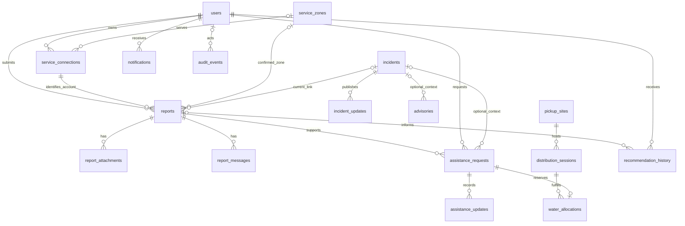

# Database schema

Status: documentation baseline, 18 October 2026. Product source: **Water Supply Reporting and Customer Assistance — Project Brief v0.4**. Related documents: [index and feature specs](README.md), [architecture](architecture.md), [requirements](requirements.md), and [workflows and workspace](workspace.md).

## Implemented database

**No database is implemented in this repository. There are no implemented tables, relationships, database constraints, migrations, seeds, or database commands to document.**

The verified baseline contains empty `aqours-api/` and `aqours-web/` directories and an Expo starter in `aqours-app/`. The [mobile package manifest](../aqours-app/package.json) and [starter routes](../aqours-app/src/app/) provide no Aqours persistence or authentication implementation. Repository inspection found no PostgreSQL connection configuration, Compose service, ORM schema, or application SQL. The intended stack in [root guidance](../AGENTS.md) is a target, not evidence that PostgreSQL or the following records exist.

Everything below is an **unimplemented first-release proposal** derived from the brief. Logical record names describe responsibilities; they do not prescribe an installed ORM, migration filenames, or a finalized physical schema. Before implementation, migrations must establish the chosen keys, types, checks, indexes, and transaction behavior and be verified against the documented workflows.

## Proposed storage conventions

| Concern | Proposed first-release representation and boundary |
| --- | --- |
| Database | Standard containerized PostgreSQL; no PostGIS or other spatial extension is required. Persistent storage, backup, and restore are separate operational concerns described in [architecture](architecture.md) and [workspace](workspace.md). |
| Keys | Every record has a stable primary key (`id` below). Foreign keys express relationships. Identifier format remains undecided; customer tracking and pickup references are separate, unique public references and grant no access by themselves. |
| Time | Event times use `TIMESTAMPTZ` and UTC instants; clients display them in `Asia/Manila` initially. Distinguish customer-reported `noticed_at` from server-recorded submission, publication, acceptance, and completion times. |
| Coordinates | WGS84 `latitude` and `longitude` in `DOUBLE PRECISION` columns. Row checks require both null or both present, latitude between -90 and 90, and longitude between -180 and 180. Missing or failed geocoding remains null; never substitute `(0, 0)`. |
| Location provenance | Preserve address text, source (`saved_address`, `geocoded_address`, or `gps`), confirmation/review state, and relevant geocoder candidate/confidence or GPS accuracy where available. Zone confirmation is separate from coordinate confirmation. |
| Geometry | Optional service-zone boundaries and published incident/advisory areas are GeoJSON in `JSONB`, validated before storage. Maps receive point arrays in `[longitude, latitude]` order. Shapes and map clusters aid display; explicit zone links and staff-confirmed associations drive matching. |
| Text and files | Store descriptions and messages as text with API validation and safe rendering. Store file metadata and ownership links in PostgreSQL; uploaded bytes belong in controlled file/object storage. Do not use public file paths as authorization. |
| Quantities | Water uses liters only. Requested, reserved, and collected quantities use exact positive `NUMERIC` values; stock totals are nonnegative exact `NUMERIC` values. Decimal scale and any minimum increment remain implementation choices. |
| Synthetic records | Mark demonstration records or their seed dataset explicitly and carry that label into customer-visible incidents, notices, and availability. Fixtures use fictional people, connections, zones, and contact details. |
| Retention | Preserve status, publication, linking, allocation, and cancellation history. Prefer restricted deletion for referenced records; retention, account deactivation, and eventual redaction policies still need definition. |

## Proposed relationship overview

This is a logical overview, not an implemented ER diagram. Supporting history, rule, targeting, and session records are described separately below to keep the diagram readable.



All foreign keys and optionalities below are proposed. An incident represents a supplier-managed event; an individual report remains the customer's record after linking. One report has at most one current incident, while one incident may have many reports.

## Proposed core records

### Identity and service location

| Record | Key attributes and relationships | Required invariants and access |
| --- | --- | --- |
| `users` | PK `id`; unique normalized login identifier; password hash; role `customer`, `staff`, or `admin`; account state; profile/contact information; creation time. | Never store plaintext passwords or expose hashes. Customer identity comes from authentication, not a supplied owner ID. Accounts are seeded/provisioned for the demo; public registration is optional and has no implemented schema. Account-management and detailed role permissions remain a proposal in [requirements](requirements.md). |
| `service_connections` | PK `id`; unique fictional connection reference; FK `customer_id -> users`; optional confirmed FK `service_zone_id -> service_zones`; saved service address, coordinate pair, provenance, and review state. | A connection belongs to a customer. Changing a report's issue location must not overwrite this saved address. Enforce ownership when a report or advisory match uses the connection. Unconfirmed zone assignments are flagged for review. |
| `service_zones` | PK `id`; unique zone code/name; descriptive metadata; optional GeoJSON boundary; active/demo markers. | Three fictional zones are proposed for the demonstration. A boundary does not establish actual water-supply connectivity. Assign connections, reports, incidents, notices, and sessions using explicit, reviewed relationships. |

### Reports and incidents

| Record | Key attributes and relationships | Required invariants and access |
| --- | --- | --- |
| `reports` | PK `id`; unique tracking reference; FKs `customer_id -> users`, `service_connection_id -> service_connections`; optional FKs `service_zone_id -> service_zones`, `incident_id -> incidents`, and assigned staff owner; category, description, `noticed_at`, server `submitted_at`, status, issue-address/location snapshot and provenance; priority and reason. | Categories: `outage`, `low_pressure`, `leak`, `water_quality`. Statuses: `received`, `under_review`, `in_progress`, `resolved`. A separate reviewed closure outcome for `duplicate` or `invalid` is proposed so it cannot be mistaken for service restoration. Keep closure reason, actor, and time. A report connection must belong to its customer. Coordinates may remain missing/reviewable without blocking submission. |
| `report_attachments` | PK `id`; FK `report_id -> reports`; uploader, storage key, detected media type, byte size, upload time and processing state. | API validates allowed type and size, derives access through the owning report, and protects download/retry endpoints. A storage key is not a public URL. Failed or incomplete uploads must not appear as successfully attached photos. |
| `report_messages` | PK `id`; FK `report_id -> reports`; author FK; customer-visible message/clarification text; creation time. | Persist two-way customer/staff messages separately from supplier-only notes. Every read/write is checked against report ownership or authorized staff access. Edits, if supported, need history rather than silently rewriting the timeline. |
| `incidents` | PK `id`; category, summary, workflow status, assigned staff FK, event times, restoration estimate or explicit unknown state; estimated affected-customer count and its source/time; optional published affected-area GeoJSON. | Statuses: `investigating`, `confirmed`, `work_in_progress`, `monitoring`, `resolved`. Use explicit zone associations, not map clusters. Unique reporting connections are counted separately from estimated affected customers. Unknown estimates must never be replaced by invented times or counts. |
| `incident_updates` | PK `id`; FK `incident_id -> incidents`; author/publisher FK; stable publication-event ID; published status/area/progress snapshot; restoration estimate or explicit unknown; publication time and demo marker. | A published update is customer-facing. Keep drafts/internal notes elsewhere. Publication, its timeline event, and notification creation/durable notification work commit together. Preserve published revisions and correction history; customer views must not expose unpublished edits. |
| `advisories` | PK `id`; notice kind and, for quality notices, distinct `boil_water`, `do_not_drink`, or `do_not_use` type; approved guidance/source reference; effective interval; published text/area; publication/lifting state, actors and times; revision identifier; optional incident FK. | Model scheduled interruptions and quality advisories without conflating safety instructions. Target explicit zones/connections through proposed associations. Publish or lift only through an authorized action; neither incident resolution nor a planned end time automatically lifts a quality advisory. Retain the exact published revision, source, and lifting reason for timelines and recommendation review. |

The report row records the issue location at submission independently of the saved connection. A later profile address edit must not silently move a historical report. A severe single report remains reviewable; neither a nearby-report count nor a confirmed incident is required for priority assessment.

### Assistance and water pickup

| Record | Key attributes and relationships | Required invariants and access |
| --- | --- | --- |
| `assistance_requests` | PK `id`; FKs `customer_id -> users`, `report_id -> reports`; optional `incident_id -> incidents`; type `callback`, `inspection`, or `water_support`; workflow status; assigned owner after acceptance; requested/accepted/scheduled/started/completed times; agreed appointment; outcome/reason fields. | The linked report belongs to the customer. Statuses: `requested`, `accepted`, `scheduled`, `in_progress`, `completed`, `unavailable`, `cancelled`. Prevent more than one active request of the same type for the same customer/report. Acceptance requires an authorized staff owner. Immediate support may skip scheduling only with a recorded reason. Unavailability, cancellation, and rescheduling retain reasons/history. |
| `assistance_updates` | PK `id`; FK `assistance_request_id -> assistance_requests`; author; customer-visible status/progress/appointment or pickup information; creation/publication time. | Customer-visible history excludes internal notes. Notify the customer about acceptance, agreed schedules, progress, rescheduling, unavailability, cancellation and completion. A request submission is distinct from acceptance or scheduling. |
| `pickup_sites` | PK `id`; supplier-managed name; address, optional coordinate pair and provenance; instructions; active/demo markers. | Sites are presented as a usable list even if maps fail. Availability comes from sessions, not merely the site's active flag. Two fictional sites are proposed for the demo. |
| `distribution_sessions` | PK `id`; FK `pickup_site_id -> pickup_sites`; operating start/end; status; total liters; instructions; stock/demo update times; explicit served-zone associations. | Require valid operating intervals and nonnegative stock. Represent available, full and cancelled outcomes. Do not reduce total stock below existing reserved/collected commitments. Session cancellation records a reason, releases uncollected reservations, informs affected customers, and records follow-up. |
| `water_allocations` | PK `id`; unique FK `assistance_request_id -> assistance_requests`; FK `distribution_session_id -> distribution_sessions`; exact positive liters; unique pickup reference; allocation state `reserved`, `collected`, or `released`; reservation, collection/release times and actor/reason. | Only a `water_support` request can allocate stock. Reserve at acceptance, collect once, and release uncollected quantities on cancellation. Retain released rows instead of deleting history. Allocation changes are transactional and idempotent; see the stock protocol below. |

**Proposed type-specific modeling choice:** use one common request workflow plus one-to-one detail records keyed by `assistance_request_id`. Their physical names and migration design are not finalized. Exactly one detail type must match the parent request; enforce the invariant in the API transaction and, where practical, database constraints.

| Detail record | Proposed stored fields |
| --- | --- |
| Callback/support details | Customer question; preferred contact method/number and time window; agreed appointment; contact outcome and next steps. A missed callback and subsequent reschedule remain in history. |
| Inspection details | Issue details; site-address/location snapshot; preferred visit window; access instructions; agreed visit; staff findings and next steps. No separate inspector role/app is implied. |
| Water-support details | Requested liters; selected session FK, if one is available; customer notes. The accepted allocation records the actual reserved session/quantity and pickup reference. With no pickup option, preserve the request and offer callback/support. |

Customer cancellation is allowed before work or collection begins. A released allocation cannot later be collected. **Proposed session-cancellation outcome:** pending/uncollected water requests become `unavailable` with the session-cancellation reason and support follow-up; collected requests retain their recorded outcome. Customer cancellation uses `cancelled`. Confirm the detailed transition policy before implementation. Completing any assistance request does not resolve its report, incident, or advisory.

### Notifications, recommendations, and audit

| Record | Key attributes and relationships | Required invariants and access |
| --- | --- | --- |
| `notifications` | PK `id`; recipient FK `user_id -> users`; stable source-event key; customer-safe type/text; relevant record link; creation/read times. | A uniqueness constraint on `(user_id, source_event_key)` deduplicates notifications even when the same publication matches multiple owned reports/connections. Check recipient ownership on list, read, and update endpoints and check access again at the linked record. Initial delivery is persisted in-app polling/refetch; external channel delivery records are deferred. |
| `recommendation_history` | PK `id`; customer FK; optional report/request FKs; evaluation time; rule version; input snapshot/references; incident/advisory revision and availability references; recommended action, explanation, source/update time, and selected/declined alternative where supplied. | Persist the reason and the relevant inputs without treating a recommendation as an accepted service request. Restrict customer access to their own history. Reevaluation must distinguish current output from superseded guidance; do not present an old evaluation as current after source changes. Rule evaluation remains API-owned. |
| `audit_events` | PK `id`; actor FK or identified system actor; action; target record/type; server time; relevant before/after status or references; reason and correlation/event key. | Append evidence for publication/lifting, priority changes, linking corrections, transitions, rule edits and stock actions. Keep logs restricted; exclude passwords, tokens, private file contents and unnecessary personal data. Audit events supplement, rather than replace, domain histories and transactional constraints. |

## Proposed supporting structures

These responsibilities need persisted records or equivalent explicitly designed constraints; none exists today. Names below describe logical structures rather than promised table names.

| Structure | Purpose and relationship |
| --- | --- |
| Authentication sessions | User FK; hashed/token-verifier material as appropriate to the chosen authentication design; expiry, revocation and last-used times. Logout/account revocation must invalidate the relevant session. Browser cookie/CSRF and mobile secure-storage choices are detailed in [architecture](architecture.md); raw credentials do not belong here. |
| Report status and incident-link events | Report FK; prior/new status or old/new incident FKs; actor, reason and time. Preserve link/unlink/reassignment history while `reports.incident_id` identifies the current association. Include individual `still affected` feedback and the resulting review without reopening an incident automatically. |
| Incident participation assertions | Proposed unique customer/connection/incident association linked to the customer's personal report. Repeated `mark affected` actions reuse that assertion/report transactionally. This deduplicates the action without forbidding separate reports about distinct problems; staff link corrections retain history. |
| Incident status events | Incident FK; prior/new status, actor, reason and time for every transition. Published text remains separate in `incident_updates`. |
| Assistance transition/appointment history | Request FK; old/new status or appointment, actor, reason and time. Keep requested windows separate from staff-agreed times, including missed callbacks, reschedules, cancellations and immediate-support exceptions. Customer-visible updates are an intentional projection of this history. |
| Supplier internal notes | Report, incident, or assistance target; staff author; text and creation time. Enforce valid target relationships. Notes never appear in customer DTOs, attachments, notifications or timelines. The table organization is undecided. |
| Zone and advisory targets | Junction relationships for an incident's zones, an advisory's zones/connections, and a distribution session's served zones. Use foreign keys and unique association pairs. A connection or report's current reviewed zone remains explicit; optional shapes do not substitute for these links. |
| Advisory revisions and lifecycle events | Advisory FK; immutable published text/type/area/source revision; publishing/lifting actor and time; reason. Retain old revisions referenced by recommendations and notifications. Corrections and lifting create explicit events, not destructive overwrites. |
| Approved guidance and rule versions | Versioned supplier-approved guidance, source/update time, rule definition/version, author and activation history. Link quality advisories and recommendation evaluations to the exact versions used. Proposed default: admin controls approved guidance/rules and official advisory publication/lifting; staff handles operational incident updates, subject to confirmation in [requirements](requirements.md). |
| Idempotency records | Authenticated actor, operation and request key; payload fingerprint; committed result/event reference; creation and expiry. A unique scoped key prevents retry duplication; reuse with different input is rejected. Retention/expiry must cover the supported retry window. |
| Optional notification outbox | If notification fan-out is asynchronous, commit a durable event alongside publication and process it with stable deduplication keys. A direct transaction inserting notification rows is also acceptable. Choose and verify one reliable approach before implementation; an outbox is not installed here. |

## Integrity and transaction rules

### Enforcement boundaries

Database checks and API authorization solve different problems. Foreign keys alone do not authorize a customer, and a normal row `CHECK` cannot protect an aggregate stock total across allocations.

| Invariant | Proposed database enforcement | Required API/transaction enforcement |
| --- | --- | --- |
| Valid row values | PKs/FKs; required fields; category/status values; coordinate range/paired-null checks; positive quantities; valid time intervals; unique references. | Validate input length, formats, geocoder confirmation, text/file policy and allowed state transitions. Validate full GeoJSON structure. Unknown/unconfirmed locations remain reviewable. |
| Owned connection/report | A composite FK or equivalent integrity design can bind the report's connection/customer pair and the assistance request's report/customer pair. | Derive the customer from the authenticated session and scope every query, including attachments, notifications, recommendation history and assistance. Staff/admin access follows backend role checks. |
| One active request per type | Proposed partial unique index on customer, report and type for `requested`, `accepted`, `scheduled`, `in_progress`. | Return the existing request or a clear conflict on retries; closing one request does not discard its history. No recommendation silently creates a request. |
| One current incident | Nullable report incident FK plus immutable link history; proposed unique customer/connection/incident participation assertion. | Confirm suggested links as staff; update the current association and history atomically. Repeated `mark affected` actions reuse the personal report rather than creating new records. |
| Authorized publication and separation | Revision relationships; unique publication/event IDs; notification recipient/event uniqueness. | Authorize publishing/lifting; commit publication and notification rows or outbox work together. Customer serializers expose only published areas/text and owned record locations. |
| Consistent mutations | Unique scoped idempotency keys, allocation/request uniqueness, and restricted writes. | Check key/payload, perform the transition and related history/notifications, and persist the operation result in the same transaction. Replay only committed results. Duplicate retries cannot create a second report, update, reservation or collection. |

Status changes, priority changes, publication, and link corrections record actor/time/reason as applicable. First-response metrics start at server report submission and end at the first qualifying staff acknowledgment; resolution metrics end at reviewed report resolution. The exact qualifying events and exclusions must match [requirements](requirements.md) and remain queryable from history rather than inferred from mutable `updated_at` fields.

### Stock protocol

For each distribution session:

```text
remaining liters = total stock liters
                 - sum(liters in reserved allocations)
                 - sum(liters in collected allocations)
```

Released allocations contribute zero. A collected allocation is no longer counted as reserved, so collection does not subtract the same quantity twice.

1. Acceptance locks the selected session and request/allocation records in a consistent order, verifies an eligible session and `remaining liters >= requested liters`, reserves the positive requested quantity, assigns the staff owner, and records acceptance/history/notification in one transaction.
2. Every operation that changes stock totals or allocations uses the same session lock protocol (or an equivalently verified serializable/database operation). Recompute/check available stock inside the transaction; concurrent approvals cannot each spend the same remaining quantity. A nonnegative row check on `total_stock` alone is insufficient.
3. Collection checks the request/allocation is eligible and uncollected, records collection once, and commits the outcome/history together. A replay with the same idempotency key returns the committed result without another mutation; a new collection attempt against an already collected or released allocation is rejected. Neither path deducts stock again.
4. Request cancellation before work/collection releases the reservation with actor/time/reason and retains history. Session cancellation blocks further acceptance, releases all uncollected reservations, records resulting request outcomes/follow-up, and notifies all affected customers. Already collected stock stays collected.
5. Stock corrections cannot reduce total stock below reserved plus collected liters. Handle concurrency, transaction rollback and retries explicitly; a map or client-side availability display is never the acceptance authority.

This protocol is a requirement for future implementation, not verified running behavior. If denormalized counters are chosen later, their updates and reconciliation must preserve this same equation transactionally.

## Demo fixtures and deferred structures

Repeatable development-only seeds are required later, but do not exist yet. The proposed dataset contains one supplier context, three synthetic zones, twelve fictional customer connections with documented individual accounts, incidents covering all four categories, two pickup sites, available/full/cancelled session examples, and all three assistance types. Include unmatched reports, unknown/conflicting information, a still-affected case, and explicit demo labels on estimates, advisories and stock. A deliberate reset operation and demo account list must be documented when implemented; do not publish real passwords or personal data here.

Required first-release records above are **unimplemented**, not deferred features. The following structures are outside this build:

- Billing accounts, invoices, commerce orders, payments and refunds.
- Home-delivery orders, vehicles, drivers, routes and fleet tracking. Water fulfillment is supplier-managed pickup/distribution.
- Multi-supplier/tenant membership and tenant isolation tables; the initial scope proposes one supplier.
- IoT readings, sensor devices and automated water-safety diagnoses.
- AI chat transcripts, model output pipelines and autonomous actions; the academic decision-support rubric remains unresolved, and rules-based assistance is proposed.
- SMS, email, push and WebSocket delivery infrastructure; initial notifications are persisted in-app records.
- Continuous background location, public household-location datasets, and spatial-extension indexes/functions. Android foreground GPS is optional; ordinary coordinates and explicit zones serve this release.

Remaining design choices include identifier format, migration/data-access tooling, exact authentication/session design, role-grant details, guidance/rule storage representation, idempotency retention, the physical incident-participation association, quantity precision, and data-retention policy. These choices must be resolved during implementation without reopening confirmed PostgreSQL, Android, MapLibre, Geoapify, or the three assistance-service decisions.
